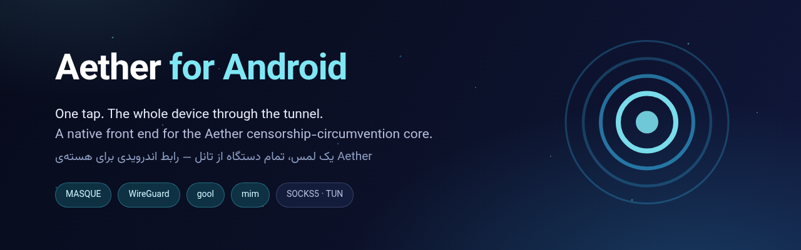
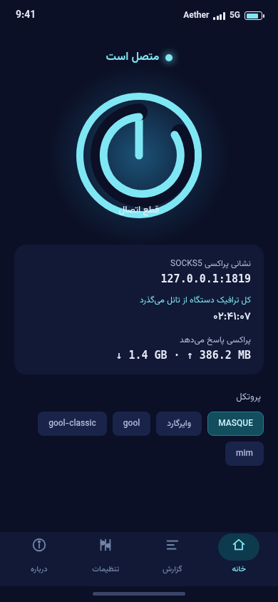
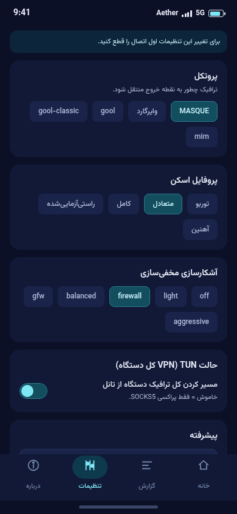
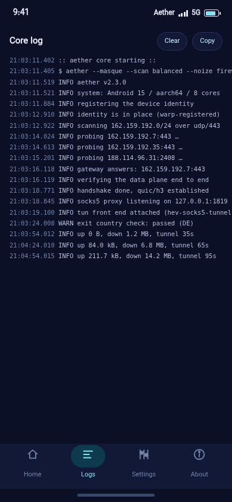

<p align="center">
  
</p>

<h1 align="center">Aether for Android</h1>

<p align="center">
  <b>One tap — the whole device through the tunnel.</b><br>
  A native Android front end for the <a href="https://github.com/CluvexStudio/Aether">Aether</a> censorship-circumvention core.<br>
  <a href="#-%D9%81%D8%A7%D8%B1%D8%B3%DB%8C">فارسی</a> · English
</p>

<p align="center">
  <a href="https://github.com/7436789/Aether/actions/workflows/android.yml"></a>
  <a href="https://github.com/7436789/Aether/releases/latest"></a>
  
  
  
</p>

---

<p align="center">
  
  
  
</p>

## Downloads

Grab the APK from the [latest release](https://github.com/7436789/Aether/releases/latest):

| Package | For |
| --- | --- |
| `Aether-arm64-v8a-v…apk` | **64-bit phones** — almost every device since 2019 |

Every release also ships a `SHA256SUMS.txt`. The APK is signed — when built without a
configured signing secret, each build gets its own key, so remove the old app before
installing an update built from a different run.

## What this app does

- **Real VPN mode.** A `VpnService` TUN front end ([zeptun](https://github.com/Noisemux/zeptun),
  a tun2socks engine written in Zig) routes the whole device through the tunnel — apps, DNS,
  everything — while the app's own sockets stay outside so the tunnel never loops back onto
  itself. Every engine `.so` is 16 KB aligned, as Android 15+ requires.
- **Proxy mode.** Prefer wiring things yourself? The core serves its SOCKS5 endpoint on
  `127.0.0.1:1819` either way; the Home screen shows it live.
- **All the transports.** MASQUE over HTTP/3 or HTTP/2, classic WireGuard, `gool`
  (WireGuard-in-MASQUE), `gool-classic`, and `mim` — plus the scan profiles
  (`turbo → ironclad`) and the `noize` obfuscation profiles the core supports.
- **Tor & transports included.** Builds ship with the `tor` feature: lyrebird
  (obfs4 / webtunnel / snowflake / meek) and psiphon ride along as bundled transports.
- **Live speeds and sessions.** The Home screen shows download / upload rates, cumulative
  volume and live TCP / UDP session counts, straight off the zeptun engine's counters.
- **Bilingual UI.** فارسی (RTL) and English, switchable in-app.
- **You can watch it think.** The core's native log stream is captured and shown in the
  Logs tab — scans, handshakes, reconnects, stats — the same output the CLI prints.
- **Auto-healing.** Reconnection and quick-reconnect to the last known-good gateway are
  the core's own; the app reflects the healing instead of guessing.

## How it works

```
┌──────────────────────────── your phone ────────────────────────────┐
│                                                                    │
│  apps ──► TUN (VpnService) ──► zeptun (Zig) ──────┐               │
│                                                    │ 127.0.0.1:1819│
│  your browser ──────────────────── SOCKS5 ─────────┘               │
│                                                        │           │
│              libaether.so (Rust core, in-process FFI) ◄─┘           │
│              MASQUE · WireGuard · gool · mim · tor                  │
│                        │ (excluded from the VPN)                   │
└────────────────────────┼───────────────────────────────────────────┘
                         ▼
                     the open internet
```

The Rust core is loaded in-process through its stable JSON FFI (`aether_core_start` /
`job_poll` / `job_cancel`) — no root, no Termux, no separate binaries to babysit except
the two Go transports, which Android extracts per ABI and the app hands to the core by
path. zeptun is statically linked into a single `libzeptun-jni.so` (~270 KB) that gets
the descriptor straight from `VpnService.Builder`, so device routing is standard Android
plumbing, not hacks.

## Repository layout

This repository **is the Android UI** — the app lives at the root:

```
app/                 the Kotlin + Jetpack Compose application
aether/              the Rust core source (AGPL-3.0), built per release
quiche/              the QUIC fork the core builds against
pt-build.sh          builds lyrebird (Tor pluggable transports)
psiphon-build.sh     builds psiphon-tunnel-core
.github/workflows/android.yml   CI: native libs → signed arm64 APK → release
```

## Building

CI does the heavy lifting: any push to `main` (or a `v*` tag) runs
[`android.yml`](.github/workflows/android.yml), which cross-compiles the core with
`cargo-ndk` + the Android NDK exactly the way upstream's release pipeline does, builds
zeptun with Zig 0.16.0 and the Go transports, then assembles and signs the APK. A full
run takes under ten minutes with the cargo cache warm.

To do it by hand:

```bash
git clone https://github.com/7436789/Aether.git
cd Aether

# 1) native libs for arm64 (needs Rust ≥1.98, NDK r26d, Go 1.22, Zig 0.16.0, CMake)
bash pt-build.sh linux arm64 "$PWD/out-pt"
bash psiphon-build.sh linux arm64 "$PWD/out-pt"
cd aether
export BORING_BSSL_RUST_CPPLIB_aarch64_linux_android=static:-bundle=c++
cargo ndk -t arm64-v8a --platform 24 build --release --features tor --lib
cd ..
git clone https://github.com/Noisemux/zeptun.git && cd zeptun
ABIS="arm64-v8a" sh scripts/build_android.sh
cd ..

# 2) the app (needs JDK 17 + Android SDK)
mkdir -p app/src/main/jniLibs/arm64-v8a
cp aether/target/aarch64-linux-android/release/libaether.so app/src/main/jniLibs/arm64-v8a/
cp zeptun/zig-out/android/jniLibs/arm64-v8a/libzeptun-jni.so app/src/main/jniLibs/arm64-v8a/
cp out-pt/lyrebird app/src/main/jniLibs/arm64-v8a/liblyrebird.so
cp out-pt/psiphon-tunnel-core app/src/main/jniLibs/arm64-v8a/libpsiphon-tunnel-core.so
./gradlew assembleRelease
```

## FAQ

**Install blocked / "unknown apps"?** — Allow installs from your browser or file
manager once; the APK isn't on Play Store.

**Battery / always-on?** — The core is quiet when idle and the TUN worker is a single
small native thread with a bounded packet pool; it's comparable to other local-VPN apps.

**Can I keep using my own proxy apps?** — Yes. Turn TUN mode off in Settings and dial
`socks5://127.0.0.1:1819` from whatever you like.

**Reproducible signing?** — Set the `ANDROID_KEYSTORE_B64` / `ANDROID_KEYSTORE_PASSWORD` /
`ANDROID_KEY_ALIAS` / `ANDROID_KEY_PASSWORD` repository secrets and every build signs
with your key.

---

## 🇮🇷 فارسی

**اتر برای اندروید** — با یک لمس، تمام ترافیک دستگاه از تانل هسته‌ی
[Aether](https://github.com/CluvexStudio/Aether) می‌گذرد: MASQUE روی HTTP/3 یا HTTP/2،
وایرگارد، gool و mim، همراه با پروفایل‌های اسکن و مخفی‌سازی، و پشتیبانی Tor و
psiphon به‌صورت توکار.

- **حالت VPN کامل:** رابط TUN با zeptun (موتور tun2socks به زبان Zig) کل دستگاه را
  از تانل رد می‌کند؛ سوکت‌های خودِ اپ بیرون از VPN می‌مانند تا حلقه‌ی مسیریابی شکل
  نگیرد.
- **حالت پراکسی:** سوکت‌های خودتان را به `socks5://127.0.0.1:1819` وصل کنید.
- **سرعت و نشست‌های زنده:** صفحه‌ی اصلی، سرعت دانلود/آپلود، حجم مصرفی و تعداد
  نشست‌های فعال TCP/UDP را از شمارنده‌های خودِ موتور نشان می‌دهد.
- **رابط فارسی و انگلیسی** با راست‌چین کامل.
- **گزارش زنده‌ی هسته:** هرچه هسته، arti و ترنسپورت‌ها می‌نویسند، در تب «گزارش»
  می‌بینید.
- **ترمیم خودکار:** اتصال مجدد و اتصال سریع به آخرین دروازه‌ی سالم، کار خودِ هسته است.

دانلود از [انتشارها](https://github.com/7436789/Aether/releases/latest):
نسخه‌ی `arm64-v8a` برای گوشی‌های ۶۴ بیتی.
برای بیلد دستی هم `android.yml` دقیقاً همان مسیر آپ‌استریم (cargo-ndk + NDK r26d +
zeptun با Zig و ترنسپورت‌های Go) را طی می‌کند.

---

## Credits & license

- The **[Aether core](https://github.com/CluvexStudio/Aether)** and its quiche fork, by
  **CluvexStudio** — this project is a community front end and is **not** an official
  CluvexStudio product. Aether's name and logo belong to their owners; the art in this
  repository is original.
- [zeptun](https://github.com/Noisemux/zeptun) by Noisemux (MIT) — TUN → SOCKS5,
  with warm SOCKS5 pooling, full-cone UDP NAT and ICMP forwarding.
- lyrebird (Tor pluggable transports) and psiphon-tunnel-core, built by the upstream
  scripts.

Everything here — the core, the transports and this UI — is **AGPL-3.0** free software:
the complete, buildable source ships with every distribution.
